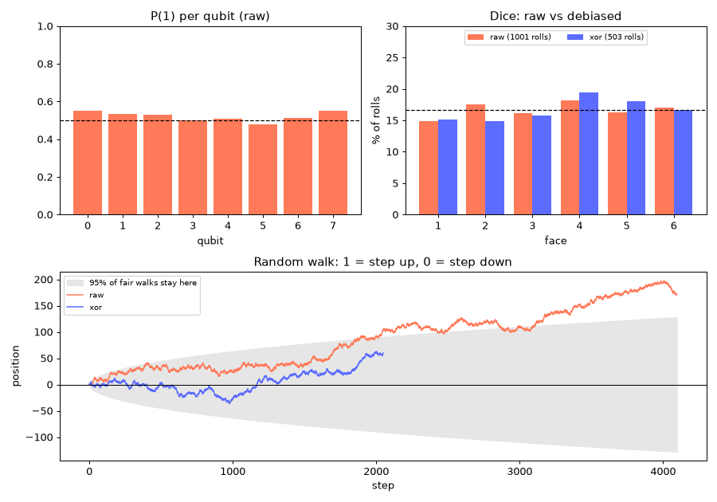
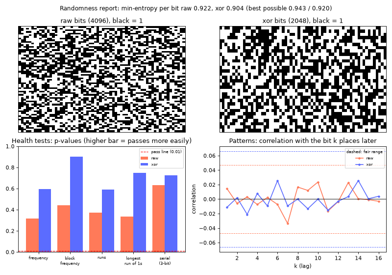

# quRandom

**qrand**: noise-aware random numbers from a quantum circuit. Submission for the Qollab Hackathon.

Every qubit gets a Hadamard gate and is measured, so each one is a 50/50 coin flip. A single
circuit job fills an *entropy pool*, and numbers are carved out of it. qrand measures each qubit's
bias (noisy hardware often reads `1` a little more than `0`) and can remove it with `xor` or
`von_neumann` debiasing.

New here? Start with the tutorial notebook,
[notebooks/qrand_tutorial.ipynb](notebooks/qrand_tutorial.ipynb). See [docs/USAGE.md](docs/USAGE.md) for the full API: ranges, bit costs and how many numbers a
job gives you. [docs/PROJECT_PAGE.md](docs/PROJECT_PAGE.md) has the project write-up, and
[docs/DEMO_SCRIPT.md](docs/DEMO_SCRIPT.md) has the demo video plan.

## Getting started

```bash
python -m venv .venv
source .venv/bin/activate
pip install -e ".[plot,dev]"
```

## Usage

On Qollab, open the project and press **Run**. `main.py` uses the `backend` Qollab provides.

Locally, run the demo on Qiskit's built-in simulator:

```bash
python main.py
```

### What the demo shows

One run sends a single circuit job and prints six sections:

1. **The circuit:** a Hadamard gate on every qubit, then a measurement.
2. **Bitstring → number:** 16 measured bits turned into an integer.
3. **How random is this run?** P(1) per qubit, a table of five NIST SP 800-22 health tests
   (frequency, block frequency, runs, longest run, serial), and a **randomness score** for raw
   and debiased bits: tests passed, min-entropy per bit, and whether any pattern links a bit to
   the next 16 bits.
4. **Random walk:** every bit is a step, `1` up and `0` down. A fair walk of `n` steps ends
   within `±2√n` about 95% of the time; a bias toward `1` makes it drift out of that range. The
   demo compares the raw walk with the debiased one.
5. **Dice, raw vs debiased:** dice rolled from both sets of bits, the share of each face, and a
   chi-square fairness test.
6. **Using the numbers:** dice rolls, a float in `[0, 1)` and a shuffle.

With **Plot** on it also draws this chart:



*This example comes from a test backend with a simulated 3% bias toward `1`: the raw walk
(orange) ends at +172, outside the ±128 band, while the debiased walk (blue) stays inside. On an
unbiased simulator both walks stay inside the band.*

A second chart, the **randomness report**, shows each run at a glance:



- **Bit images:** every bit as a pixel (black = 1). Random bits look like TV static; a bias shows
  as more black, and a pattern shows as stripes or bands.
- **Health tests:** the p-value of each test, raw vs debiased, with the 0.01 pass line.
- **Patterns:** the correlation between each bit and the bit 1 to 16 places later. Fair bits stay
  inside the dashed range of `±3/√n`.
- **Min-entropy** in the title: how many truly random bits each bit is worth (NIST SP 800-90B
  estimate at 99% confidence), next to the best score possible for that many bits.

*This example is a run on Qiskit's built-in simulator.*

The walk and dice comparison only read the bits the job already produced; they don't use up the
pool or send extra jobs.

The run ends with a **result line**. Collect lines from different backends in
[docs/DEVICE_RESULTS.md](docs/DEVICE_RESULTS.md) to compare how fair each device's qubits are.

### Run settings

On Qollab, these appear under **Run settings** in the Select QPU dialog. Locally,
`python main.py` uses the defaults; to try other values, change them in the `def main(...)` line.

| Setting | Default | Notes |
| --- | --- | --- |
| `shots` | 512 | more shots give more numbers and make a bias easier to see in the walk |
| `qubits` | 8 | must be even with `xor` |
| `debias` | `xor` | `xor`, `von_neumann` or `none` |
| `plot` | on | draw the chart |

### Run on real quantum hardware

No login or API key is needed. On Qollab, the IonQ account and key belong to Qollab, which
creates the `backend` for whatever you pick in **Select QPU**. The same code runs on simulators
and hardware; only quantum computers cost credits.

1. **Try the free simulator of the same machine first.** Pick **IonQ Forte 1** under *Remote
   simulator*. It uses IonQ's noise model of that machine and costs nothing.
2. **Check the machine is online.** Offline machines show in the Select QPU dialog, and
   maintenance is posted at [status.ionq.co](https://status.ionq.co).
3. **Pick the quantum computer.** Choose **IonQ Forte 1** or **IonQ Forte Enterprise 1** under
   *Quantum computer*.
4. **Keep shots low at first.** Cost grows with shots. 512 shots × 8 qubits already gives about
   500 die rolls with `xor`.
5. **Approve the price.** The runner shows an estimated cost next to your balance and waits.
   Decline and nothing is charged. The final charge can differ a little from the estimate.
6. **Read the output.** The console says `(real quantum hardware)` next to the backend name, and
   the closing note says the bits are physically random. Waiting in IonQ's queue can take a
   while; the console prints a predicted wait.

Keep API keys out of the code: published Qollab code is public.

**Not yet tested on hardware:** we had no Qollab credits during the hackathon, so this path
has been checked against IonQ's Qiskit backend objects and the IonQ remote simulators, but
not run on a real quantum computer.

### In your own code

```python
from qrand import QuantumRandom

qr = QuantumRandom(backend, n_qubits=8, shots=512, debias="xor")  # backend=None uses a local simulator
qr.randint(1, 6)
qr.random()
qr.report()  # per-qubit bias and NIST-style health tests
```

The helpers behind the demo work on any bitstring:

```python
from qrand import stats

walk = stats.random_walk(qr.raw_bits)          # positions, starting at 0
rolls = stats.dice_from_bits(qr.pool_bits())   # die rolls 1-6
counts = [rolls.count(f) for f in range(1, 7)]
stats.chi2_uniform_p(counts)                   # >= 0.01: consistent with a fair die
```

## Tests

```bash
pytest
```

## Project layout

```
qrand/       library: generator (entropy pool, debiasing) and stats (health tests,
             random walk, dice, chi-square)
main.py      Qollab demo: console sections and chart
tests/       pytest tests
docs/        usage guide, project page, demo script, device results, example chart
notebooks/   tutorial notebook (qrand_tutorial.ipynb)
```

## Team

- [@mazeeqe](https://github.com/mazeeqe)

## License

MIT, see [LICENSE](LICENSE).
