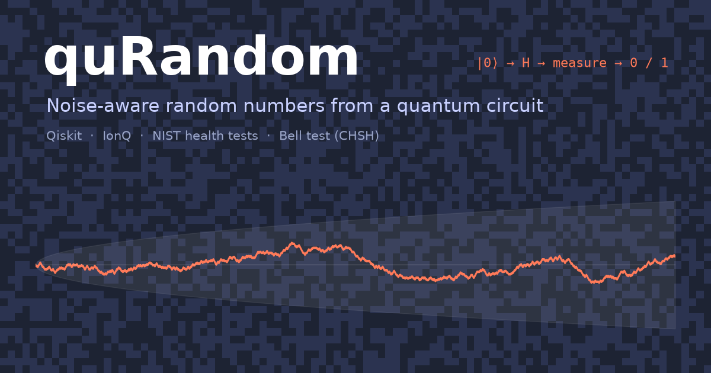

# Setting up the Qollab Project Card

Everything to fill in on the **Project Card** tab. Changes save as you type.

## Title

```
quRandom: noise-aware quantum random numbers
```

## Thumbnail

Drag and drop [`docs/images/thumbnail.png`](images/thumbnail.png) (1200 × 630) onto the thumbnail
area, or click **Browse**. It is what people see wherever the project is listed.



## About (sidebar summary)

```
Random numbers from measured qubits, with a fairness check for every run: per-qubit bias, NIST health tests, min-entropy, a random walk that makes bias visible, debiasing, plus two quantum ideas you can watch happen: superposition (un-flipping a quantum coin) and entanglement (a Bell test). One circuit, one job: runs on Qollab's free simulators, including IonQ.
```

## Description (the write-up)

Paste the whole of [`docs/PROJECT_PAGE.md`](PROJECT_PAGE.md) into the Markdown editor, then use
**Preview** to check it.

The pictures in it are linked from this public GitHub repository
(`https://raw.githubusercontent.com/mazeeqe/quRandom/main/docs/images/...`), so they show up
without uploading anything. If Preview shows broken images, Qollab is blocking outside images:
upload the files from `docs/images/` into the editor instead, if it allows that, or remove the
image lines.

The write-up has two equations in `$$ ... $$`. If Preview shows them as plain text, use the
toolbar's **math** button to re-enter them.

## Tags

```
qiskit, ionq, random-numbers, bell-test, chsh, entanglement, noise, nist, random-walk, hackathon
```

## Links

- **Git repository:** `https://github.com/mazeeqe/quRandom`
- **Website:** leave empty, or use the demo video link once it is uploaded.

## Pictures

All pictures are in `docs/images/`. Regenerate them with `python scripts/make_figures.py`.

| File | Shows | Used in |
| --- | --- | --- |
| `thumbnail.png` | title card with random-bit background and a random walk | thumbnail |
| `how_it_works.png` | one circuit → one job → check & debias → numbers, plus the Bell test | write-up, top |
| `circuit.png` | the circuit: 4 random-number qubits, the 4 Bell-test qubits and the un-flip qubit | How it works |
| `unflip.png` | share of 0s after one H vs after H then H (built-in simulator) | Superposition |
| `demo_chart.png` | per-qubit bias, dice raw vs debiased, random walks (test backend with a simulated 3% bias) | Noise-aware |
| `randomness_report.png` | bits as pixels, test p-values, correlations (built-in simulator) | How random is each run? |
| `bell_test.png` | Bell test correlations and S against the classical limit (built-in simulator) | Bell test |

The chart pictures come from the demo itself (`main.py`). Only `demo_chart.png` uses a test
backend, because an unbiased simulator shows no drift; the write-up says so under the picture.
